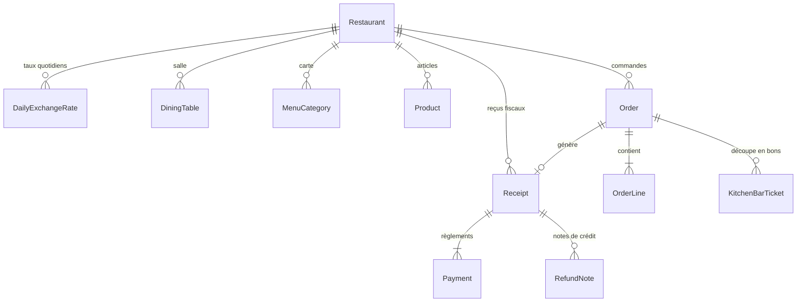

# Conception de la Persistance : Commandes, Bons Cuisine/Bar et Encaissement

Ce document propose une architecture de persistance des modules B (Commandes & Prise de commande) et C (Facturation & Encaissement) de Resto+.

> **Statut : proposition non validée.** Les éléments financiers et fiscaux ci-dessous ne constituent pas des décisions métier ou fiscales et ne doivent pas être codés comme des règles approuvées. La TVA, les arrondis, le taux de change, les frais de service, la numérotation fiscale des reçus, les remises et les remboursements attendent les validations externes listées dans [points-a-valider-fiscalite.md](points-a-valider-fiscalite.md). La règle établie pour la phase 1 reste la conservation et l'affichage séparé des montants CDF et USD sans conversion implicite; Mobile Money se limite à la saisie manuelle d'une référence.

> **État historique au 20 octobre 2026 :** le schéma et la migration candidate commandes étaient présents sans application. Le catalogue persistant a ensuite été préparé en code et dans la migration candidate `20261021100000_persistent_menu_catalog` (21 octobre 2026). Cette migration reste non exécutée; voir [catalog-persistence-design.md](catalog-persistence-design.md). La validation effective du catalogue et des commandes en PostgreSQL reste donc bloquée jusqu'aux tests isolés. Les paiements persistants et règles fiscales restent désactivés en attente de validation métier/fiscale.

---

## 1. Principes Directeurs

1. **Isolation stricte multi-restaurant (RLS)** :
   - Chaque table métier porte obligatoirement `restaurantId UUID NOT NULL`.
   - Les clés primaires logiques et clés étrangères composites incluent systématiquement `restaurantId` (ex: `FOREIGN KEY (restaurantId, orderId) REFERENCES orders(restaurantId, id)`).
   - `FORCE ROW LEVEL SECURITY` est activé sur chaque table avec politiques d'accès `USING (restaurantId = current_setting('app.restaurant_id', true)::uuid)` et `WITH CHECK`.

2. **Règles financières (Module C du Cahier des charges)** :
   - **Devises** : Le Franc congolais (`CDF`, affiché `FC`) est la monnaie de compte principale. Le Dollar américain (`USD`) est la devise secondaire acceptée.
   - **Taux de change du jour** : Défini chaque jour par le gérant (`DailyExchangeRate`), horodaté. Chaque commande/paiement fige le taux du moment, qui n'est jamais recalculé ultérieurement.
   - **TVA 16 %** : Les prix carte sont TTC. La TVA de 16 % est extraite du total TTC selon la formule fiscale :
     $$\text{TVA} = \text{round}\left(\frac{\text{TTC} \times 16}{116}\right)$$
   - **Arrondis** : Les montants à payer en CDF sont arrondis au multiple de 50 FC le plus proche (`Math.round(cdf / 50) * 50`). En USD, ils sont arrondis au centime.
   - **Rendu de monnaie** : En CDF uniquement par défaut.
   - **Numérotation des reçus** : Séquentielle continue sans trou par restaurant au format `AAAA-NNNNNN` (ex: `2026-000001`). En mode hors-ligne, un numéro provisoire d'appareil (ex: `A2-000045`) est rattaché au numéro définitif lors de la synchronisation.
   - **Remboursements** : Réservés au gérant (code PIN / session gérant), sur un reçu existant avec motif obligatoire, générant une note de crédit liée sans suppression de l'original.

3. **Circuit opérationnel des commandes (Module B & existant UX/UI)** :
   ```mermaid
   stateDiagram-v2
       [*] --> WAITING_CASHIER: Création par Serveur/Gérant (Table / À emporter)
       WAITING_CASHIER --> IN_PREPARATION: Validation Caisse (Création automatique des Bons Cuisine & Bar)
       IN_PREPARATION --> READY: Tous les bons passent à READY
       READY --> COMPLETED: Encaissement & Reçu émis
       WAITING_CASHIER --> CANCELLED: Annulation autorisée (Gérant obligatoire avec motif)
       IN_PREPARATION --> CANCELLED: Annulation autorisée (Gérant obligatoire avec motif)
   ```

---

## 2. Modèle Entités-Relations



---

## 3. Schéma Détaillé des Tables Métier

### 3.1. Taux de change (`daily_exchange_rates`)

- `id` (UUID, PK)
- `restaurantId` (UUID, FK -> restaurants.id)
- `rateDate` (DATE) — Date du taux (ex. 2026-10-20)
- `usdToCdfRate` (NUMERIC(10,2)) — Ex. 2850.00
- `setByUserId` (UUID, FK -> users.id)
- `createdAt` (TIMESTAMPTZ)
- _Contrainte_ : Unique `(restaurantId, rateDate)`

### 3.2. Tables de salle (`dining_tables`)

- `id` (UUID, PK)
- `restaurantId` (UUID, FK -> restaurants.id)
- `tableNumber` (VARCHAR(30)) — Ex. "Table 04", "VIP-1"
- `zone` (VARCHAR(30)) — "STANDARD", "TERRACE", "VIP"
- `capacity` (INTEGER)
- `status` (VARCHAR(30)) — "FREE" (vert), "OCCUPIED" (rouge), "BILL_REQUESTED" (orange)
- `isActive` (BOOLEAN)
- _Contrainte_ : Unique `(restaurantId, tableNumber)`

### 3.3. Commandes (`orders`)

- `id` (UUID, PK)
- `restaurantId` (UUID, FK -> restaurants.id)
- `orderNumber` (VARCHAR(32)) — Ex. "CMD-2026-000248" (unique par tenant)
- `tableId` (UUID nullable, FK -> dining_tables.id)
- `tableName` (VARCHAR(60)) — Dénormalisé pour affichage instantané
- `serverUserId` (UUID, FK -> users.id) — Serveur ayant saisi la commande
- `status` (VARCHAR(30)) — `WAITING_CASHIER`, `IN_PREPARATION`, `READY`, `COMPLETED`, `CANCELLED`
- `coversCount` (INTEGER) — Nombre de couverts
- `isTakeaway` (BOOLEAN) — Commande à emporter
- `notes` (TEXT nullable) — Instructions globales
- `subtotalCdf` (INTEGER) — Total brut en CDF
- `exchangeRateUsed` (NUMERIC(10,2)) — Taux USD->CDF figé à la commande
- `cashierValidatedAt` (TIMESTAMPTZ nullable)
- `cashierUserId` (UUID nullable, FK -> users.id)
- `cancelledAt` (TIMESTAMPTZ nullable)
- `cancellationReason` (TEXT nullable)
- `cancelledByUserId` (UUID nullable, FK -> users.id)
- `createdAt`, `updatedAt` (TIMESTAMPTZ)

### 3.4. Lignes de commande (`order_lines`)

- `id` (UUID, PK)
- `restaurantId` (UUID, FK -> restaurants.id)
- `orderId` (UUID, FK composite -> orders)
- `productId` (UUID, FK composite -> products)
- `productName` (VARCHAR(160))
- `station` (VARCHAR(20)) — `CUISINE` ou `BAR`
- `quantity` (INTEGER)
- `unitPriceAmount` (NUMERIC(12,2))
- `currency` (VARCHAR(3)) — `CDF` ou `USD`
- `unitPriceCdf` (INTEGER) — Équivalent CDF figé
- `subtotalCdf` (INTEGER)
- `selectedAccompaniments` (JSONB) — Ex. `["Frites", "Chikwangue"]`
- `selectedExtras` (JSONB) — Ex. `[{"name": "Piment maison", "amount": 1000, "currency": "CDF"}]`
- `notes` (VARCHAR(255) nullable) — Ex. "Bien cuit", "Sans oignons"

### 3.5. Bons Cuisine & Bar (`kitchen_bar_tickets`)

- `id` (UUID, PK)
- `restaurantId` (UUID, FK -> restaurants.id)
- `orderId` (UUID, FK composite -> orders)
- `ticketNumber` (VARCHAR(36)) — Ex. "BON-0248-C" (Cuisine) ou "BON-0248-B" (Bar)
- `station` (VARCHAR(20)) — `CUISINE` ou `BAR`
- `status` (VARCHAR(30)) — `PENDING`, `IN_PREPARATION`, `READY`
- `itemsSummary` (JSONB) — Articles, quantités, accompagnements et notes du bon
- `issuedAt` (TIMESTAMPTZ)
- `readyAt` (TIMESTAMPTZ nullable)
- `handledByUserId` (UUID nullable, FK -> users.id)

### 3.6. Reçus fiscaux & Facturation (`receipts`)

- `id` (UUID, PK)
- `restaurantId` (UUID, FK -> restaurants.id)
- `orderId` (UUID, FK composite -> orders, unique)
- `receiptNumber` (VARCHAR(32)) — Séquentiel continu sans trou `AAAA-NNNNNN`
- `provisionalNumber` (VARCHAR(32) nullable) — Ex. `A2-000045` (généré hors-ligne)
- `subtotalTtcCdf` (INTEGER)
- `taxTvaCdf` (INTEGER) — $\text{TTC} \times 16 / 116$
- `discountAmountCdf` (INTEGER DEFAULT 0)
- `discountReason` (TEXT nullable)
- `discountAuthorizedByUserId` (UUID nullable, FK -> users.id)
- `serviceFeePercent` (NUMERIC(5,2) DEFAULT 0)
- `serviceFeeCdf` (INTEGER DEFAULT 0)
- `totalDueCdf` (INTEGER) — Montant net à payer après remise et service, arrondi à 50 FC
- `totalPaidCdf` (INTEGER DEFAULT 0) — Cumul des paiements
- `changeGivenCdf` (INTEGER DEFAULT 0) — Rendu de monnaie
- `isSettled` (BOOLEAN DEFAULT false)
- `cashierUserId` (UUID, FK -> users.id)
- `createdAt`, `settledAt` (TIMESTAMPTZ)

### 3.7. Règlements (`payments`)

- `id` (UUID, PK)
- `restaurantId` (UUID, FK -> restaurants.id)
- `receiptId` (UUID, FK composite -> receipts)
- `paymentMethod` (VARCHAR(30)) — `CASH_CDF`, `CASH_USD`, `MPESA`, `ORANGE_MONEY`, `AIRTEL_MONEY`, `CARD`
- `amountPaid` (NUMERIC(12,2)) — Montant saisi dans la devise de règlement
- `currencyPaid` (VARCHAR(3)) — `CDF` ou `USD`
- `exchangeRateUsed` (NUMERIC(10,2)) — Taux appliqué au paiement
- `amountInCdf` (INTEGER) — Contre-valeur en CDF
- `referenceNumber` (VARCHAR(100) nullable) — Référence SMS Mobile Money ou terminal CB
- `cashierUserId` (UUID, FK -> users.id)
- `createdAt` (TIMESTAMPTZ)

---

## 4. Matrice des Rôles et Autorisations Serveur

| Action métier                                        |  OWNER  |       MANAGER       | CASHIER | WAITER  | KITCHEN | STOCK |
| :--------------------------------------------------- | :-----: | :-----------------: | :-----: | :-----: | :-----: | :---: |
| Définir le taux de change du jour                    | **Oui** |       **Oui**       |   Non   |   Non   |   Non   |  Non  |
| Créer une commande (salle / emporter)                | **Oui** |       **Oui**       | **Oui** | **Oui** |   Non   |  Non  |
| Valider une commande en caisse (génération des bons) | **Oui** |       **Oui**       | **Oui** |   Non   |   Non   |  Non  |
| Faire progresser un bon Cuisine / Bar                | **Oui** |       **Oui**       |   Non   |   Non   | **Oui** |  Non  |
| Encaisser une addition (tous modes)                  | **Oui** |       **Oui**       | **Oui** |   Non   |   Non   |  Non  |
| Appliquer une remise                                 | **Oui** |    **Oui** (PIN)    |   Non   |   Non   |   Non   |  Non  |
| Annuler une commande validée                         | **Oui** | **Oui** (PIN/motif) |   Non   |   Non   |   Non   |  Non  |
| Émettre un remboursement (note de crédit)            | **Oui** |   **Oui** (motif)   |   Non   |   Non   |   Non   |  Non  |

_Toute annulation, remise ou remboursement écrit obligatoirement un événement dans `SecurityAuditEvent`._
